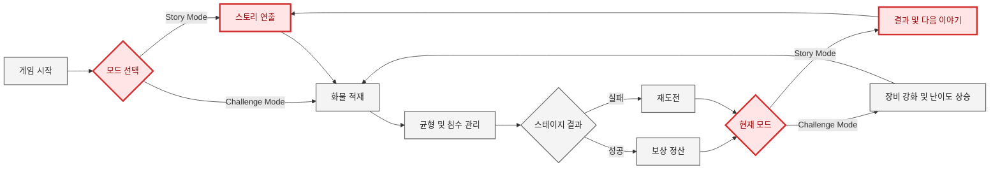

# 업데이트 기획서
### SAIL OR SUNK

**SAIL OR SUNK**는 물 위에 떠있는 배가 가라앉거나 기울어지지 않도록 균형을 잡으며 최대한 많은 물건을 던져 쌓아올려 제한 시간 내에 최대한 많은 점수를 획득하는 게임이다.  
매 스테이지에는 아래와 같은 성공/실패 분기가 있으며, 업그레이드 시스템을 통해 더 어려운 난이도로의 도전이 가능하다.
### 성공 조건
- 제한 시간 이내에 유지비를 차감하고도 양수의 점수를 달성한 경우
### 실패 조건
- 제한 시간 이내에 유지비를 차감한 최종 금액이 음수일 경우
  - 단, 0인 경우에는 현상 유지로 판정되어 스테이지가 넘어가지 않고 재도전하게 된다.
- 배가 기울어지거나 가라앉으면 작동하는 침수 게이지가 최대치로 찼을 경우
---

## 개발 의도에 부합한 사항들
첫 프로젝트로서 **SAIL OR SUNK**는 규모를 늘리는 것이 아닌, 초기 기획을 최대한 완성도있게 다듬는 것을 목표로 하였고 개발 과정에서 실제로 그 방침의 장점을 확인할 수 있었다.

- **동적 UI를 통한 시각적 완성도 및 정보 관리** : 유저가 언제 어떤 정보를 필요로 할지 생각하고, 필요할 정보만 화면에 노출되도록 요소들을 설계했다. 이러한 구조는 필수적이지는 않지만, 프로젝트가 단순한 프로토타입을 넘어 유저에게 몰입감을 제공하고 실제로 작동하는 게임처럼 보이게 만들어주는 역할을 수행할 것으로 기대되었다.
    - 일시정지 창처럼 즉각적으로 표시되어야하는 UI를 제외하면 모두 슬라이드되며 나타나도록 구현
    - 침수 게이지는 침수될 때에만 표시되도록 구현
    - 던지는 준비에는 더 넓은 시야를 제공하고, 던질 때에는 블록에 집중하는 카메라 워크를 구현
- **보완적-방어적 프로젝트 관리** : 게임의 양을 확장하는 것보다는 코어 게임 루프와 필수적인 요소부터 구현하고, 버그가 발생하지 않게 만드는 데에 집중하였다.

하지만 아래와 같은 문제점들이 여전히 남아있었고, 이러한 점들에 대한 고민들을 바탕으로 향후 업데이트 기획에서 대안을 수립할 계획이다.

## 현재 버전의 문제점
### 1. 정적이고 단조로운 게임 경험
동적 UI, 상호작용 블록, 카메라 워크 등 동적인 인상을 주기 위해 노력했지만,
결과적으로 정적인 게임 화면 구성이 되었다.  
주관적으로 느껴질 수 있는 부분이지만 게임이 정적으로 느껴지는 근거를 들면,
- 1스테이지도, 100스테이지도 모두 똑같은 게임 화면
- 상호작용 블록 등은 조건이 충족되어야만 발견할 수 있고, 그 종류와 숫자가 너무 적음
- 블록을 던지면 그 블록이 무언가에 부딪힐 때까지 가만히 있어야 하는 유저 경험
- 비주얼과 사운드가 미완성/미구현 상태이기 때문에, 유저에게 적절한 감각적 피드백을 제공하지 못함  

특히 아쉬운 것은 상호작용 블록을 기껏 만들어놓고 발동 조건을 이스터에그 수준으로 숨겨놓아서
유저들이 발견하기 어려웠다는 것이다.
### 2. 부족한 플레이 동기 설명
수박 게임이나 테트리스, 그리고 앵그리버드 등 본 프로젝트의 레퍼런스로 삼았던 훌륭한 게임들은 설명할 필요 없는 게임 자체의 재미를 갖고 있다.  
하지만 그런 게임들의 매커니즘을 답습하는 것이 아닌 '던져서 쌓고 균형을 잡는다'는 독특한 새로운 매커니즘을
채택했다면 '**왜 그래야 하는지**'를 게임 시스템 외적으로 설명해줄 필요가 있었다.  
생소한 유저 경험을 제공할 때에는 **행위의 동기를 제시**하여 따르게 만들 필요가 있기 때문이다.
### 3. 부족한 피드백 완성도
상술한 정적인 게임 경험의 원인으로도 제시되었던 부분으로 임시 리소스, 미구현 파트, 통일성 부족 등 유저들이 직접적으로 경험할 시청각적 측면에서도 여러 문제를 내포하고 있다.  
UI 연출과 핵심 루프에는 많은 공을 들였지만, 정작 그것을 채울 리소스는 비어있거나 미완성된 채로 남아있다.
### 4. 클래스 책임의 과부하
현재 코드는 각 씬에서 맡은 역할에 따라 책임을 분리해놨으나, 세부 기능까지는 구분하지 않았기에 `GameManager.cs`, `UIManager.cs` 등
매니저류 클래스 스크립트의 길이가 과도하게 길어지고 책임이 과중해졌다.

### 피드백(플레이 경험 평가)
이외에도, 유저 피드백에서 지적된 사항들은 실제 플레이 경험에서 개발 의도가 잘 작동하지 않을 수 있음을 확인할 수 있었다.
- 선박 업그레이드가 있는데, 시간은 그대로라서 아쉬웠다.
  - 이 경우는 시간을 늘려주는 업그레이드가 상점에 있음에도 설명이 부족했기 때문에 발생한 오해로, UI와 시스템의 시인성이 더욱 확보되어야한다고 느꼈다.
- 블록이 전부 랜덤이라서 의도된 게임 플레이 설계를 할 수 없다는 점이 아쉬웠다.(억까)
  - 랜덤 요소에서 오는 불확실성이 의도가 맞아 떨어졌을 때의 성취감을 증폭시키긴 하지만, 블록의 종류와 등장 시점을 조절하여 난이도의 완급 조절을 할 필요성이 있다고 느껴진다. 실제로 작동하는 게임으로 만들기 위해서는 프로토타입 수준의 난이도 설계에서 벗어나야 한다.

다만 긍정적인 평 또한 있었고, 여기서 보여지는 경험들은 프로젝트의 핵심 요소로 삼아 이후 업데이트에서도 그 가치를 보존, 유지하는 것을 목표로 한다.
- 물과 그에 상호작용하는 배, 블록 등의 움직임 구현 디테일 
- 효율적인 플레이와 마구잡이로(무지성) 던져넣는 플레이를 구분한 시스템 설계
- 시간 제한 내에 목표 점수를 달성해야 하는 플레이 경험이 도파민을 제공함
### 원인 분석
기술적인 문제 이외에 가장 큰 실책은 기술적 구현이 쉬울 거라 생각했지만, 물리 기반의 프로젝트에서 자연스러운 각종 수치값을 찾기 위한 QA 과정에서 너무 많은 시간을 써버렸다는 것이다.  
또한 리소스를 제작해 완성도를 높이려는 시도가 없었던 것은 아니었지만, UI부터 세부 리소스까지 통일성과 완성도를 맞춰 기간 내에 작업하는 데에 어려움을 겪었다.

---
## 업데이트 목표와 콘셉트
그렇다면 4주의 기간 동안 이 문제점들을 어떻게 보완할 수 있을까? 2주 동안 현재 상태까지 구현했으므로 이를 기준으로 얼마만큼의 작업이 가능할지 예상할 수 있고 이를 바탕으로 다음 버전 업데이트 계획을 세울 수 있을 것이다.
### 1. 리소스 보완과 시각적 연출 추가
단순히 아트 리소스의 퀄리티를 높이는 것을 넘어, 사운드와 특수 효과를 추가하여 게임의 동적 경험과 시청각적 피드백을 보완한다. 특수 효과는 거창하지 않더라도, 아래 정도만 추가해도 게임의 재미를 살리는 데에 큰 도움이 될 것으로 보인다.
> - 블록이 물에 빠지거나 배가 출렁일 때의 파동을 애니메이션 프리팹 등으로 표현
> - 성공했을 때 금화 파티클이 양쪽에서 콘페티처럼 터져나오는 연출
### 2. 모드를 분리하여 내러티브 요소 추가
`Story Mode`와 `Challenge Mode`를 구분하고, 스토리 모드에서는 일러스트 연출과 다이얼로그를 활용해 캐릭터와 서사를 추가함으로써 플레이어들이 어떤 상황에서 이 게임을 플레이하게 되었는지 납득할 수 있도록 만들어 자연스럽게 게임에 몰입하게 할 수 있을 것이다.
> ### Synopsis  
> 해적 생활을 동경하는 귀족 아가씨의 철없는 일탈을 결심한다.  
> 집사는 깜짝 놀라 아가씨를 말리려하지만, 얼떨결에 바다 한복판으로 함께 나와버리게 된다.  
> 세상 물정 모르는 아가씨와 꼬일대로 꼬인 상황에 넋이 나간 집사는 집으로 무사히 돌아갈 수 있을까?  
> 아니면 성공한 대해적으로 바다에 이름을 떨치게 될까?

다만 다이얼로그 시스템을 만든다는 것은 저장, 불러오기 등을 구현해야한다는 뜻이기도 하다.  
하지만 온전한 비주얼 노벨 시스템을 구현하기보다는, 추후 별도의 업데이트를 상정하고 아래와 같이 간소화한다.
- 매 씬마다 저장을 하게 만들 필요는 없고, 스테이지가 끝날 때마다 자동적으로 저장을 시키는 방식으로 작업해 UI 작업을 최소화한다.
- 불러오기 기능은 별도로 만들지 않고 저장된 데이터가 있다면 스토리 모드 진입 시 저장 시점부터 플레이하게 만든다.

이외에, `스테이지가 끝없이 올라가는` 기존의 게임 모드는 `Challenge Mode`로 분리하여 캐주얼한 게임 플레이를 지원한다.
### 3. 클래스의 책임 분리
위에서 지적했듯, 싱글톤 패턴으로 처리된 관리자형 클래스들은 불필요하게 많은 기능들을 수행하고 있다.  
예를 들어 현재의 `GameManager.cs`는 배나 블록의 객체 선언과 배치, 게임 오버의 판정, 점수 계산 등 다양한 역할을 맡고 있다.
```csharp
private void InitializeBlockQueue() {...} // 블록 큐 선언 및 할당
private void UpdateTimerDisplay() {...} // 타이머 갱신 (지금 보면 쓰이더라도 UI 매니저에 쓰였어야 할 것 같다.)
private void UpdateLootValue(int targetLoot) {...} // 점수판 갱신 (이것도)
private void IsDeckSinking() {...} // 배의 침수 상태 확인 및 처리
public Block GetNextBlock() {...} // 다음 블록 프리팹 할당
public void GameOver() {...} // 게임 오버 처리

// 등등...
```
이처럼 `GameManager.cs`, `UIManager.cs` 등 책임이 과중하게 할당되어있는 싱글톤 관리자형 클래스의 함수와 메서드를 역할별로 구분하여 특정 기능이 수행될 때 필요한 영역만 호출되도록 만들어 비용을 절감하고, 유지보수성도 크게 높일 수 있다.

### 4. 블록 등 기존 게임 요소 추가 및 보강
블록의 종류와 각자의 개성들은 게임의 핵심적인 재미 요소이자 플레이 경험을 다채롭게 만들어주는 것은 물론이고, 난이도 곡선 설계에도 중요한 역할을 한다.  
단순히 블록을 추가하고 어느 시점에 등장하게 만들지를 고민하는 것만으로도 게임의 완성도를 제고할 수 있으며, 또한 폭탄 블록의 시점 등을 조절하여 게임 요소를 지나치게 숨겨놓은 아쉬움을 만회하고자 한다.
---
## 업데이트 미리보기
### 1. 0.2ver UX Flow
새롭게 추가되는 요소는 **붉은색**으로 표시하였다.

인게임 내에서 화물을 선박 위에 적재한다는 핵심 플레이 경험은 바뀌지 않지만, 스토리 모드에서는 플레이의 결과에 따라 
스토리가 어떻게 진행될지 분기별로 처리할 수 있으며 각종 다이얼로그와 스토리 등 내러티브 요소로 인해 추가적인 플레이 동인이
발생한다.

### 2. 아트 스타일 가이드

  

예시는 사용하기 위해 작업했던 스탠딩 일러스트 이미지로, 이를 기준으로 스타일을 고정하고 타 리소스를 확장해나가는 방식으로 작업하고자 했다.  
아트 스타일은 아래 두가지 원칙을 따른다.

**효율성** : 직접 제작할 수 있는 간단한 손그림을 중심으로 작업하되, 화풍과 스타일을 해치지 않는 선에서 AI를 활용하여 작업 효율을 증진시킨다.  
**정합성** : 캐주얼한 게임 플레이 경험에 어울리는 맞는 가볍고 귀여운 아트 스타일을 지향한다.

### 3. 화면 기획 및 예시


### 4. 음향 콘셉트
캐주얼한 게임 분위기를 살리기 위해, 음향은 마찬가지로 캐주얼하면서도 코믹한 느낌의 사운드를 지향한다.  

**효과음**  
닭 블록이 부딪히거나 폭발에 휘말릴 땐 `꼬꼬댁`, 블록이 물에 빠질 때에는 `첨벙`, `퐁당`같은 소리를 통해 즉각적인 청각적 피드백을 제공한다.

**배경음(앰비언트 사운드)**  
배가 삐그덕거리는 소리, 물결이 철썩거리는 소리, 갈매기 울음 소리 등을 삽입하고 그 소리와 피치, 재생 빈도를 랜덤으로 조절하여 현실감을 높이고 단조로움을 줄인다.

**BGM**  
메인 화면에서는 `뱃노래`나 `해적`, `바다`가 연상되는 경쾌하고 밝은 음악을 사용하되, 
인게임 스테이지 화면에서는 음악이 지나치게 산만하면 플레이 경험을 방해할 수 있으므로, 메인 화면과 동일한 분위기를 공유하되 그 톤은 더 가벼운 음악을 송출한다.

### CG / 애셋 요구서
```csharp
- 그래픽
  - UI 컴포넌트
    - 공용 버튼
    - 공용 패널
    - 스플래시 이미지
      - 튜토리얼
    - 공용 텍스트 폰트
    - UI용 그래픽 리소스
      - 점수판에 사용될 금화
    - 스탠딩 일러스트 이미지
    - 시각 특수효과 리소스
      - 연출용 금화 파티클
      - 폭발 애니메이션
      - 물이 튀기는 애니메이션
  - 사운드
    - 블록 별 부딪히는 사운드
      - 나무상자
      - 벽돌
      - 바위
      - 닭
      - 폭탄
    - 특수 상호작용 사운드
      - 폭발
      - 물에 빠지는 사운드
    - 앰비언트 사운드
      - 배가 삐걱대는 소리
      - 파도가 철썩이는 소리
      - 갈매기 울음소리
      - 바람 소리
    - BGM
      - 메인 화면
      - 인게임 스테이지
```


