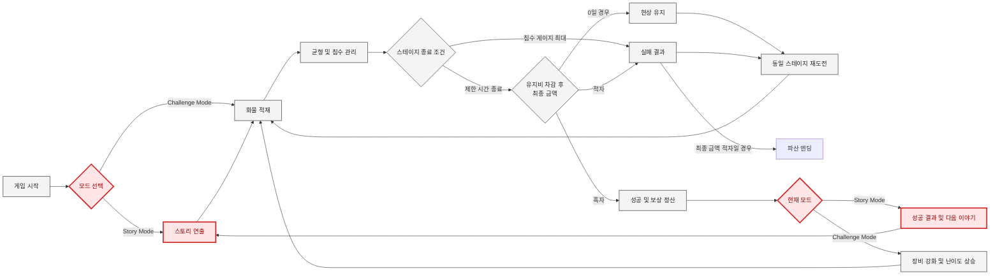

# 업데이트 기획서
### SAIL OR SUNK


**SAIL OR SUNK**는 물 위에 떠있는 배가 가라앉거나 기울어지지 않도록 균형을 잡으며 최대한 많은 물건을 던져 쌓아올려 제한 시간 내에 최대한 많은 점수를 획득하는 게임이다.  
매 스테이지에는 아래와 같은 성공/실패 분기가 있으며, 업그레이드 시스템을 통해 더 어려운 난이도로의 도전이 가능하다.
### 성공 처리
- 제한 시간 이내에 유지비를 차감하고도 양수의 점수를 달성한 경우 다음 스테이지로 넘어간다.
### 실패 처리
- 제한 시간 이내에 유지비를 차감한 최종 금액이 음수일 경우 파산 여부를 확인하고, 파산이 아니라면 해당 스테이지를 재도전한다.
  - 단, 0인 경우에는 현상 유지로 판정되어 스테이지가 넘어가지 않고 재도전하게 된다.
- 배가 기울어지거나 가라앉으면 작동하는 침수 게이지가 최대치로 찼을 경우 모든 업그레이드를 제거하고 1 스테이지부터 재시작한다.
### 게임 오버 처리
- 마지막 스테이지에서 달성한 최종 점수로 인해 소지금이 음수가 될 경우, 파산 엔딩을 보게 된다.
---

## 개발 의도에 부합한 사항들
첫 프로젝트로서 **SAIL OR SUNK**는 규모를 늘리는 것이 아닌, 초기 기획을 최대한 완성도있게 다듬는 것을 목표로 하였고 개발 과정에서 실제로 그 방침의 장점을 확인할 수 있었다.

- **동적 UI를 통한 시각적 완성도 및 정보 관리** : 유저가 언제 어떤 정보를 필요로 할지 생각하고, 필요할 정보만 화면에 노출되도록 요소들을 설계했다. 이러한 구조는 필수적이지는 않지만, 프로젝트가 단순한 프로토타입을 넘어 유저에게 몰입감을 제공하고 실제로 작동하는 게임처럼 보이게 만들어주는 역할을 수행할 것으로 기대되었다.
    - 일시정지 창처럼 즉각적으로 표시되어야하는 UI를 제외하면 모두 슬라이드되며 나타나도록 구현
    - 침수 게이지는 침수될 때에만 표시되도록 구현
    - 던지는 준비에는 더 넓은 시야를 제공하고, 던질 때에는 블록에 집중하는 카메라 워크를 구현
- **보완적-방어적 프로젝트 관리** : 게임의 양을 확장하는 것보다는 코어 게임 루프와 필수적인 요소부터 구현하고, 버그가 발생하지 않게 만드는 데에 집중하였다.

하지만 아래와 같은 문제점들이 여전히 남아있었고, 이러한 점들에 대한 고민들을 바탕으로 향후 업데이트 기획에서 대안을 수립할 계획이다.

## 현재 버전의 문제점
### 1. 기획 측면 : 정적이고 단조로운 게임 경험
동적 UI, 상호작용 블록, 카메라 워크 등 동적인 인상을 주기 위해 노력했지만,
결과적으로 정적인 게임 화면 구성이 되었다.  
주관적으로 느껴질 수 있는 부분이지만 게임이 정적으로 느껴지는 근거를 들면,
- 1스테이지도, 100스테이지도 모두 똑같은 게임 화면
- 상호작용 블록 등은 조건이 충족되어야만 발견할 수 있고, 그 종류와 숫자가 너무 적음
- 블록을 던지면 그 블록이 무언가에 부딪힐 때까지 가만히 있어야 하는 유저 경험
- 비주얼과 사운드가 미완성/미구현 상태이기 때문에, 유저에게 적절한 감각적 피드백을 제공하지 못함  

특히 아쉬운 것은 상호작용 블록을 기껏 만들어놓고 발동 조건을 이스터에그 수준으로 숨겨놓아서
유저들이 발견하기 어려웠다는 것이다.
### 2. 기획 및 구현 측면 : 부족한 플레이 동기 설명
수박 게임이나 테트리스, 그리고 앵그리버드 등 본 프로젝트의 레퍼런스로 삼았던 훌륭한 게임들은 설명할 필요 없는 게임 자체의 재미를 갖고 있다.  
하지만 그런 게임들의 매커니즘을 답습하는 것이 아닌 '던져서 쌓고 균형을 잡는다'는 독특한 새로운 매커니즘을
채택했다면 '**왜 그래야 하는지**'를 게임 시스템 외적으로 설명해줄 필요가 있었다.  
생소한 유저 경험을 제공할 때에는 **행위의 동기를 제시**하여 따르게 만들 필요가 있기 때문이다.
### 3. 구현 측면 : 부족한 피드백 완성도
상술한 정적인 게임 경험의 원인으로도 제시되었던 부분으로 임시 리소스, 미구현 파트, 통일성 부족 등 유저들이 직접적으로 경험할 시청각적 측면에서도 여러 문제를 내포하고 있다.  
UI 연출과 핵심 루프에는 많은 공을 들였지만, 정작 그것을 채울 리소스는 비어있거나 미완성된 채로 남아있다.
### 4. 구현 및 구조 설계 측면 : 클래스 책임의 과부하
현재 코드는 각 씬에서 맡은 역할에 따라 책임을 분리해놨으나, 세부 기능까지는 구분하지 않았기에 `GameManager.cs`, `UIManager.cs` 등
매니저류 클래스 스크립트의 길이가 과도하게 길어지고 책임이 과중해졌다.

### 피드백(플레이 경험 평가)
이외에도, 유저 피드백에서 지적된 사항들은 실제 플레이 경험에서 개발 의도가 잘 작동하지 않을 수 있음을 확인할 수 있었다.
- 선박 업그레이드가 있는데, 시간은 그대로라서 아쉬웠다.
  - 이 경우는 시간을 늘려주는 업그레이드가 상점에 있음에도 설명이 부족했기 때문에 발생한 오해로, UI와 시스템의 시인성이 더욱 확보되어야한다고 느꼈다.
- 블록이 전부 랜덤이라서 의도된 게임 플레이 설계를 할 수 없다는 점이 아쉬웠다.(억까)
  - 랜덤 요소에서 오는 불확실성이 의도가 맞아 떨어졌을 때의 성취감을 증폭시키긴 하지만, 블록의 종류와 등장 시점을 조절하여 난이도의 완급 조절을 할 필요성이 있다고 느껴진다. 실제로 작동하는 게임으로 만들기 위해서는 프로토타입 수준의 난이도 설계에서 벗어나야 한다.

다만 긍정적인 평 또한 있었고, 여기서 보여지는 경험들은 프로젝트의 핵심 요소로 삼아 이후 업데이트에서도 그 가치를 보존, 유지하는 것을 목표로 한다.
- 물과 그에 상호작용하는 배, 블록 등의 움직임 구현 디테일 
- 효율적인 플레이와 마구잡이로(무지성) 던져넣는 플레이를 구분한 시스템 설계
- 시간 제한 내에 목표 점수를 달성해야 하는 플레이 경험이 도파민을 제공함
### 그 외 일정 측면에서의 문제
기술적인 문제 이외에 가장 큰 실책은 기술적 구현이 쉬울 거라 생각했지만, 물리 기반의 프로젝트에서 자연스러운 각종 수치값을 찾기 위한 QA 과정에서 너무 많은 시간을 써버렸다는 것이다.  
또한 리소스를 제작해 완성도를 높이려는 시도가 없었던 것은 아니었지만, UI부터 세부 리소스까지 통일성과 완성도를 맞춰 기간 내에 작업하는 데에 어려움을 겪었다.

---
## 업데이트 목표와 콘셉트 : 몰입적 UX 보강 및 코드 구조 합리화
그렇다면 4주의 기간 동안 이 문제점들을 어떻게 보완할 수 있을까? 2주 동안 현재 상태까지 구현했으므로 이를 기준으로 얼마만큼의 작업이 가능할지 예상할 수 있고 이를 바탕으로 다음 버전 업데이트 계획을 세울 수 있을 것이다.
> v0.2 업데이트는 캐릭터와 시청각 피드백을 통해 플레이 동기와 몰입감을 강화하고, 신규 기능에 필요한 코드 책임을 정리하는 것을 목표로 한다.

### 1. 리소스 보완과 시각적 연출 추가
단순히 아트 리소스의 퀄리티를 높이는 것을 넘어, 사운드와 특수 효과를 추가하여 게임의 동적 경험과 시청각적 피드백을 보완한다. 특수 효과는 거창하지 않더라도, 아래 정도만 추가해도 게임의 재미를 살리는 데에 큰 도움이 될 것으로 보인다.
> - 블록이 물에 빠지거나 배가 출렁일 때의 파동을 애니메이션 프리팹 등으로 표현
> - 성공했을 때 금화 파티클이 양쪽에서 콘페티처럼 터져나오는 연출
### 2. 모드를 분리하여 내러티브 요소 추가
`Story Mode`와 `Challenge Mode`를 구분하고, 스토리 모드에서는 일러스트 연출과 다이얼로그를 활용해 캐릭터와 서사를 추가함으로써 플레이어들이 어떤 상황에서 이 게임을 플레이하게 되었는지 납득할 수 있도록 만들어 자연스럽게 게임에 몰입하게 할 수 있을 것이다.
> ### Synopsis  
> 해적 생활을 동경하는 귀족 아가씨의 철없는 일탈을 결심한다.  
> 집사는 깜짝 놀라 아가씨를 말리려하지만, 얼떨결에 바다 한복판으로 함께 나와버리게 된다.  
> 세상 물정 모르는 아가씨와 꼬일대로 꼬인 상황에 넋이 나간 집사는 집으로 무사히 돌아갈 수 있을까?  
> 아니면 성공한 대해적으로 바다에 이름을 떨칠 수 있을까?

내러티브 요소는 다음과 같은 세가지 콘셉트 키워드를 중점으로 삼는다.  
>`캐주얼 해적 모험` · `코믹한 긴장감` · `직관적 피드백`

이외에, `스테이지가 끝없이 올라가는` 기존의 게임 모드는 `Challenge Mode`로 분리하여 캐주얼한 게임 플레이를 지원한다.
### 3. 클래스의 책임 분리
위에서 지적했듯, 싱글톤 패턴으로 처리된 관리자형 클래스들은 불필요하게 많은 기능들을 수행하고 있다.  
예를 들어 현재의 `GameManager.cs`는 배나 블록의 객체 선언과 배치, 게임 오버의 판정, 점수 계산 등 다양한 역할을 맡고 있다.
```csharp
private void InitializeBlockQueue() {...} // 블록 큐 선언 및 할당
private void UpdateTimerDisplay() {...} // 타이머 갱신 (지금 보면 쓰이더라도 UI 매니저에 쓰였어야 할 것 같다.)
private void UpdateLootValue(int targetLoot) {...} // 점수판 갱신 (이것도)
private void IsDeckSinking() {...} // 배의 침수 상태 확인 및 처리
public Block GetNextBlock() {...} // 다음 블록 프리팹 할당
public void GameOver() {...} // 게임 오버 처리

// 등등...
```
이처럼 `GameManager.cs`, `UIManager.cs` 등 책임이 과중하게 할당되어있는 싱글톤 관리자형 클래스의 기능별 책임을 분리하여 수정 영향 범위를 줄이고, 기능 간 결합도를 낮춰 유지보수성과 테스트 용이성을 높인다.

### 4. 블록 등 기존 게임 요소 추가 및 보강
블록의 종류와 각자의 개성들은 게임의 핵심적인 재미 요소이자 플레이 경험을 다채롭게 만들어주는 것은 물론이고, 난이도 곡선 설계에도 중요한 역할을 한다.  
단순히 블록을 추가하고 어느 시점에 등장하게 만들지를 고민하는 것만으로도 게임의 완성도를 제고할 수 있으며, 또한 폭탄 블록의 시점 등을 조절하여 게임 요소를 지나치게 숨겨놓은 아쉬움을 만회하고자 한다.

### 5. 상점 등 UI 시인성 보완
현재는 영어로 적혀있지만 한글 폰트를 지원하고, 툴팁도 더욱 직관적이고 쉽게 이해 가능한 문장으로 정리한다.

### 업데이트 계획 최종 정리
> 모드 분리와 스토리-내러티브 콘텐츠는 플레이 행위의 목적을 설명하고, 다이얼로그와 상점 UI는 해당 정보를 전달한다. 물보라·충돌·결과 연출과 음향 피드백은 플레이 중 발생한 결과를 즉시 인식하게 한다. 네 요소는 각각 독립적으로 추가되는 것이 아니라, 플레이 동기 제시부터 행동 결과 전달까지 하나의 경험을 보완하도록 구성한다.
---
## 업데이트 미리보기
### 1. 0.2ver UX Flow
새롭게 추가되는 요소는 **붉은색**으로 표시하였다.

인게임 내에서 화물을 선박 위에 적재한다는 핵심 플레이 경험은 바뀌지 않지만, 스토리 모드에서는 스테이지 전후에 다이얼로그와 일러스트 연출을 배치하고, 성공·실패 결과에 따라 캐릭터의 반응 대사를 다르게 출력한다. 전체 스토리 진행 경로는 선형적 구조로 유지한다.

### 2. 아트 스타일 가이드

  

예시는 사용하기 위해 작업했던 스탠딩 일러스트 이미지로, 이를 기준으로 스타일을 고정하고 타 리소스를 확장해나가는 방식으로 작업하고자 했다.  
아트 스타일은 아래 두가지 원칙을 따른다.

**효율성** : 직접 제작할 수 있는 간단한 손그림을 중심으로 작업하되, 화풍과 스타일을 해치지 않는 선에서 AI를 활용하여 작업 효율을 증진시킨다.  
**정합성** : 캐주얼한 게임 플레이 경험에 어울리는 맞는 가볍고 귀여운 아트 스타일을 지향한다.

  

다만 배경 CG가 캐릭터와 그대로 똑같은 밀도로 작업될 경우, 전체적인 화면의 밀도가 적어보이는 느낌이 들 수 있다. (지브리 애니메이션 등에서도 배경은 수채화로 작업하고 움직이는 인물은 셀식으로 작업하듯이)  
따라서, 배경은 생성형 AI 활용을 통해 화풍을 통일, 통제하면서 컨셉과 스타일을 그대로 유지, 양산하여 위와 같이 퀄리티를 확보한다.
  

### 3. 화면 기획 및 예시

#### 카메라 연출

현재 버전에서 카메라 연출 범위는 아래와 같다.

| 항목          | 현재 구현 여부                                         |
|-------------|--------------------------------------------------|
| 추적  대상 및 방식 | 투척 준비 중에는 선박과 적재 공간 전체를 보여주고, 투척 후에는 현재 블록을 추적한다 |
| 줌           | 조준 단계에서 시야를 넓히고, 투척 후 기본 배율로 복귀한다                |  

여기서 특수 상호작용 등에도 적용되는 특별한 카메라 동작 액션을 추가하여 게임 플레이의 몰입감을 더하도록 한다.

| 항목 | 0.2ver에서 구현할 내용                             |
|---|---------------------------------------------|
| 화면 흔들림 | 일반 충돌에는 적용하지 않으며 폭탄 폭발과 침수 실패에만 짧고 약하게 적용한다 |
| 구현 범위 | 폭발·침수 이펙트와의 연동만 추가한다     |

#### 추가되는 화면 구성

0.2ver 업데이트 기획에서는 다이얼로그 화면 이외에는 별도의 시스템 구성을 가진 화면이 등장하지 않는다.
다이얼로그 시스템에서는 온전한 비주얼 노벨 시스템을 구현하기보다는, 추후 별도의 업데이트를 상정하고 아래와 같이 간소화한다.

> 매 씬마다 저장을 하게 만들 필요는 없고, 스테이지가 끝날 때마다 자동적으로 저장을 시키는 방식으로 작업해 UI 작업을 최소화한다.  
> 수동 저장 및 불러오기 UI는 구현하지 않는다. 스테이지 종료 시 진행 상황을 자동 저장하고, Story Mode 진입 시 가장 최근 저장 지점에서 자동으로 이어서 시작한다.

  다이얼로그 화면 예시  

  메인 화면 예시  

추가로, 여유가 있다면 단순히 일러스트 CG를 통째로 메인 화면에 쓰는 것이 아닌 층별로 레이어를 분리한 후 Dotween을 이용해 적합한 움직임을 적용하여 더욱 완성도 높은 화면 연출을 구성할 수 있을 것이다.
> **레이어 분리 예시**
> - 전경 사물 (풀숲, 나무) : 크기와 회전값을 조정하여 바람에 흔들리는 것처럼 만들 수 있을 것이다.
> - 전경 (흙바닥, 바위 등)
> - 파도 물결 : 파도를 현실적으로 구현하기 위해서는 별도의 스프라이트 애셋이 필요할 것으로 보인다.
> - 중경 (바다 위에 떠있는 섬이나 해안가 등)
> - 원경 (바다 너머에 보이는 섬이나 바위 등)~~~~
> - 구름 : 예외로, 두트윈을 사용하지 않고 인게임에 적용된 구름처럼 풀링과 위치 초기화를 이용해 한쪽으로 계속해서 흘러가게 만든다.
> - 하늘

### 4. 음향 콘셉트 기획
#### 4.1 현재 게임의 사운드 진단
현재 버전은 물리 기반 움직임과 UI 연출은 구현되어 있지만, 이를 뒷받침하는 사운드가 미구현되어있어 플레이어의 행동과 게임 상태가 충분히 전달되지 않는다.  
특히 블록이 배에 충돌하거나 물에 빠지는 순간, 폭탄이 발동하는 순간처럼 게임 상태가 크게 변하는 상황에서도 청각적 반응이 부족하다.  
이로 인해 플레이어는 충돌의 강도, 블록의 특성, 침몰 위험 등을 화면 정보에만 의존해야 한다.

또한 해상이라는 공간적 배경을 전달할 앰비언트 사운드가 없어 배와 바다가 정적인 배경처럼 느껴지며, 스테이지 성공과 실패 시에도 결과를 강조하는 음향 연출이 부족하여 보상과 위기의 감정 변화가 약하게 전달된다.

따라서 v0.2에서는 다음 세 가지 문제를 우선적으로 보완한다.

- 블록 충돌과 특수 상호작용에 대한 즉각적인 효과음 제공
- 배와 바다의 공간감을 형성하는 앰비언트 사운드 추가
- 일반 플레이, 위기, 성공, 실패 상황을 구분하는 음악적 변화 적용

#### 4.2 업데이트 음향 콘셉트

> **가볍고 코믹한 해적 모험 분위기를 유지하면서, 충돌·위험·보상의 상태 변화를 직관적으로 전달하는 반응형 음향을 구성한다.**

음향은 사실적인 해상 환경을 그대로 재현하는 것보다 캐주얼한 게임 플레이에 맞게 소리를 과장하고 단순화하는 방향으로 제작한다. 블록 충돌음은 재질의 차이를 알아들을 수 있도록 구분하되 지나치게 무겁거나 위협적으로 만들지 않으며, 닭과 폭탄 등 특수 블록에는 코믹한 반응음을 추가한다.

#### 4.3 상황별 음향 기획

v0.2에서는 별도의 보스 캐릭터나 전투 시스템을 추가하지 않는다. 아래 표에서 `보스·클라이맥스`는 Story Mode의 최종 스테이지 또는 침몰 위험과 특수 블록 출현 빈도가 가장 높은 고난도 스테이지를 의미한다.

| 상황 | BGM 콘셉트 | 주요 SFX 및 앰비언트 | 연출 목적 |
|---|---|---|---|
| 메인 메뉴·모드 선택 | 밝고 경쾌한 해양 모험 분위기. 아코디언, 휘슬, 어쿠스틱 기타, 가벼운 타악기 중심의 짧은 루프 | 버튼 선택음, 버튼 확정음, 멀리서 들리는 파도와 갈매기 소리 | 게임 시작 전부터 해적과 바다라는 배경을 전달하고, Story Mode와 Challenge Mode에 부담 없이 진입하도록 한다 | 
| 일반 스테이지 | 일정한 박자를 유지하되 플레이를 방해하지 않는 가벼운 리듬. 멜로디 반복을 줄이고 타악기와 베이스 중심으로 구성 | 블록별 충돌음, 약한 배 삐걱거림, 파도, 바람, 갈매기, 블록 투척음, 물에 빠지는 소리 | 블록의 재질과 물리적 상호작용을 즉시 전달하고, 반복 플레이에서 음악으로 인한 피로를 줄인다 | 
| 위기 상황 | 기존 인게임 BGM을 교체하기보다 템포가 빠른 타악기 레이어와 낮은 음역의 반복음을 추가 | 강한 배 삐걱거림, 물이 차오르는 소리, 침수 경고음, 게이지 경고음, 강한 충돌음 | 음악의 급격한 전환으로 플레이를 방해하지 않으면서 침몰 위험이 증가했음을 청각적으로 경고한다 | 
| 보스·클라이맥스 | 일반 스테이지의 음악적 주제를 유지하면서 타악기, 브라스 계열 음색, 빠른 리듬을 추가한 고조된 변형곡 | 폭탄 점화음, 폭발음, 연쇄 충돌음, 강한 물보라, 선박 충격음 | 새로운 장르의 음악을 삽입하기보다 기존 모험 분위기를 확장하여 최종 또는 고난도 스테이지임을 인식시킨다 | 
| 스테이지 성공 | 짧고 상승하는 음형의 성공 징글. 메인 테마의 일부를 2~4초 길이로 변형 | 금화 획득음, 점수 합산음, 금화 파티클과 동기화된 반짝임 효과음 | 스테이지 성공과 보상 획득을 즉시 인식시키고, 다음 스테이지에 도전할 동기를 제공한다 | 
| 현상 유지·0점 | 성공보다 낮고 짧은 중립적 징글. 실패처럼 무겁지는 않지만 진행되지 않았음을 표현 | 정산 중단음, 짧은 동전 소리, UI 표시음 | 완전한 실패는 아니지만 같은 스테이지를 다시 플레이해야 한다는 결과를 성공·실패와 구분한다 | 
| 실패·침몰 | 짧게 하강하는 음형을 사용하되 지나치게 비극적이지 않은 코믹한 마무리 | 큰 물보라, 배가 가라앉는 소리, 블록이 연속으로 물에 빠지는 소리, 실패 UI 표시음 | 침몰이나 최종 금액 부족을 분명하게 전달하면서도 재도전에 대한 부담을 줄인다 | 
| Story Mode 다이얼로그 | 별도의 강한 멜로디를 사용하지 않고, 인게임 또는 메뉴 BGM의 음량과 고음역을 낮춘 버전 사용 | 대사 출력음, 다음 대사 진행음, 캐릭터 등장음 | 대사의 가독성을 우선하고, 게임 플레이와 스토리 장면이 완전히 분리된 느낌을 줄인다 | 
| Challenge Mode 결과·재도전 | 성공 또는 실패 징글 이후 인게임 테마로 빠르게 복귀 | 점수 갱신음, 최고 기록 알림음, 재도전 버튼음 | 스토리 감상보다 반복 도전과 기록 갱신에 집중할 수 있도록 결과 연출을 짧게 유지한다 |

#### 4.4 주요 효과음 구성

블록 충돌음은 모든 블록에 동일한 소리를 적용하지 않고 재질과 특성에 따라 구분한다.

| 대상 | 효과음 방향 | 적용 방식 | 연출 목적 |
|---|---|---|---|
| 나무상자 | 속이 빈 나무가 부딪히는 가벼운 충돌음 | 충돌 강도에 따라 음량과 피치를 소폭 변경 | 블록의 가벼운 무게와 재질을 전달한다 |
| 벽돌 | 짧고 건조한 돌 충돌음 | 강한 충돌 시 작은 파편음을 추가 | 나무상자보다 단단하고 무거운 블록임을 구분한다 |
| 바위 | 저음이 강조된 둔탁한 충돌음 | 큰 충격에서만 강한 저음 레이어를 재생 | 배의 균형에 큰 영향을 주는 무거운 블록임을 강조한다 |
| 닭 | 가벼운 충돌음과 짧은 울음소리 | 충돌할 때마다 여러 울음소리 중 하나를 무작위 재생 | 특수 블록의 코믹한 개성과 시인성을 강화한다 |
| 폭탄 | 금속성 충돌음과 짧은 심지 반응음 | 충돌음과 폭발음을 분리하여 재생 | 일반 충돌과 실제 폭발 상태를 명확하게 구분한다 |
| 물에 빠진 블록 | 블록 크기에 따른 `첨벙`, `퐁당` 계열 입수음 | 블록 질량과 충돌 속도에 따라 음량과 피치를 변경 | 블록이 적재에 실패하고 바다로 이탈했음을 즉시 전달한다 |
| 선박 | 나무 삐걱거림과 선체 충격음 | 기울기와 침수 게이지가 높을수록 재생 빈도를 증가 | UI를 확인하지 않아도 선박의 위험 상태를 감지하도록 한다 |

#### 4.5 음향과 아트 스타일의 일관성

v0.2의 아트 스타일은 가볍고 귀여운 캐릭터 표현, 단순하고 명확한 실루엣, 과장된 시각 효과를 중심으로 한다. 따라서 음향 역시 사실적인 해상 시뮬레이션보다는 플레이어가 결과를 빠르게 알아들을 수 있는 과장되고 직관적인 표현을 사용한다.

예를 들어 닭 블록에는 실제 닭의 환경음을 그대로 사용하는 대신 짧고 명확한 울음소리를 배치하고, 블록이 물에 빠질 때에는 실제 입수음보다 리듬감이 분명한 `첨벙` 소리를 사용한다. 이는 캐릭터와 오브젝트를 귀엽고 코믹하게 표현하는 아트 방향과 일치하며, 물리 현상을 복잡한 설명 없이 전달하는 데에도 효과적이다.

UI와 이펙트 역시 같은 원칙을 따른다. 금화 파티클이 출력될 때는 밝고 높은 음역의 금화 효과음을 함께 재생하고, 폭발 애니메이션에는 짧고 과장된 폭발음을 동기화한다. 시각 효과와 효과음의 시작 시점을 일치시켜 플레이어가 원인과 결과를 하나의 사건으로 인식하도록 한다.

일반 스테이지의 BGM은 경쾌한 해양 모험 분위기를 유지하되 멜로디와 악기 수를 제한하여 블록의 충돌음과 위험 경고음이 묻히지 않게 한다. 반대로 메뉴와 스토리 장면에서는 아코디언, 휘슬 등 해적과 항해를 연상시키는 음색을 더 적극적으로 사용하여 세계관과 캐릭터의 분위기를 전달한다.

이를 통해 캐릭터·UI·이펙트·음향이 각각 분리된 요소로 느껴지는 것을 방지하고, 전체 게임을 다음의 공통된 인상으로 통일한다.

> **밝고 경쾌한 해적 컨셉의 모험 속에서, 무거운 화물을 시간 안에 아슬아슬하게 쌓아 올리는 코믹한 긴장감**

## CG / 에셋 요구서

본 요구서는 v0.2 업데이트에서 새로 제작하거나 개선해야 하는 시각 에셋을 정리한 것이다.  
에셋 제작 범위는 4주 내 구현 가능성을 고려하여 스토리 모드에 필요한 캐릭터와 다이얼로그 UI, 기존 플레이의 시각적 피드백을 강화하는 이펙트, 모드 분리와 정보 전달에 필요한 UI를 우선 대상으로 설정한다.  
애셋 확보 가능성 측면에서, 효과음은 자연음 위주이기 때문에 애셋을 구해서 사용하기에 적합하고 이미지는 직접 만들 수 있더라도 AI 제작 후 리터칭하는 것을 기조로 하여 시간을 확보하는 것이 안전할 것으로 보인다.

| ID      | 에셋명                  | 종류 | 규격                                                            | 배치 위치                            | 연출 목적                                                                 | 확보 방법                                           |
|---------|----------------------|---|---------------------------------------------------------------|----------------------------------|-----------------------------------------------------------------------|-------------------------------------------------|
| CHR-001 | 클라라 기본 스탠딩 일러스트 세트   | 캐릭터 / 표정 | 투명 배경 PNG, 세로 2048px 이상, 캐릭터 전신이 잘리지 않도록 제작                   | Story Mode 도입부, 스테이지 전후 다이얼로그 화면 | 스토리의 중심 인물을 시각적으로 제시하고, 플레이어가 대사의 화자를 즉시 인식하도록 한다                     | 기존 시안 기준 직접 제작 및 AI로 확장                         |
| CHR-002 | 집사 기본 스탠딩 일러스트 세트    | 캐릭터 / 표정 | 투명 배경 PNG, 세로 2048px 이상, CHR-001과 비슷한 화면 점유율 유지               | Story Mode 도입부와 스테이지 전후 다이얼로그 화면 | 클라라와 대화하는 상대를 제시하고, 두 캐릭터의 관계를 통해 플레이 동기와 상황을 설명한다                    | 기존 시안 기준 직접 제작 및 AI로 확장                                   |
| CHR-003 | 상점 주인 스탠딩 일러스트 세트    | 캐릭터 / 표정 | 투명 배경 PNG, CHR-001, 002와 동일한 캔버스 및 위치, 기본·당황·체념 등 2~3종       | Story Mode 다이얼로그 화면              | 철없는 클라라와 어딘가 어설픈 집사 사이의 정상인이지만, 자신의 이익을 위해 입다물고 있는 캐릭터로 상황을 객관적으로 보여준다 | 기존 시안 기준 직접 제작 및 AI로 확장           |
| BG-001  | 스토리 도입 배경            | 배경 일러스트 | PNG, 1920×1080px, 16:9 비율                                     | Story Mode의 최초 도입 다이얼로그 화면       | 게임 시작 전 캐릭터가 처한 장소와 상황을 전달하고, 플레이가 시작되는 맥락을 제공한다                      | AI 생성 후 직접 보정                                   |
| BG-002  | 인게임 배경        | 배경 / 인게임 화면 재사용 | 1920×1080px 기준, 런타임 블러 및 명도 감소 적용                             | 스테이지 중에 송출할 백그라운드 CG             | 기존 인게임 배경 CG 역할을 수행하되, 스테이지 다이얼로그가 들어가도 어색하지 않도록 레이아웃을 조정해야 한다        | 기존 인게임 카메라 화면을 재사용하고 Unity UI 또는 셰이더로 블러 처리     |
| OBJ-001 | 신규 특수 블록 외형          | 오브젝트 / 2D 스프라이트 | 투명 배경 PNG, 512×512px 이상, 충돌 영역을 고려한 여백 최소화                    | 인게임 블록 생성 위치와 선박 갑판              | 기존 블록 조합에 새로운 물리적 특성과 선택지를 추가하여 반복 플레이의 변화를 만든다                       | 직접 제작 또는 기존 블록 스타일을 기준으로 AI 생성 후 보정             |
| OBJ-002 | 폭탄 블록 개선 스프라이트       | 오브젝트 / 2D 스프라이트 | 투명 배경 PNG, 512×512px 이상, 기존 콜라이더 비율 유지                        | 인게임 블록 생성 위치와 선박 갑판              | 폭탄 블록이 일반 블록과 명확하게 구분되도록 만들어 특수 상호작용의 존재와 위험성을 쉽게 인지하게 한다             | 기존 폭탄 블록 리소스를 직접 수정                             |
| OBJ-003 | 배경 장식 오브젝트 세트        | 오브젝트 / 배경 스프라이트 | 투명 배경 PNG, 오브젝트별 256~1024px, 섬·구름·갈매기 등 3종 이내                 | 인게임 배경 레이어                       | 스테이지 배경에 가벼운 움직임과 변화를 부여하여 정적인 화면 구성을 완화한다                            | 직접 제작 또는 기존 배경 요소를 분리·재가공                       |
| UI-001  | 공용 버튼 세트             | UI / 9-Sliced 스프라이트 | PNG, 기준 크기 600×160px, 기본·포인터 오버·클릭·비활성 상태                     | 메인 메뉴, 모드 선택, 상점, 결과 화면          | 화면별로 달랐던 버튼 표현을 통일하고, 상호작용 가능 상태를 명확히 전달한다                            | 직접 제작                                           |
| UI-002  | 공용 패널                | UI / 9-Sliced 스프라이트 | PNG, 기준 크기 1200×600px, 모서리와 테두리 영역 분리                         | 안내창, 결과창, 상점, 다이얼로그 보조 패널        | 서로 다른 화면의 UI를 동일한 시각 언어로 묶어 전체적인 아트 스타일의 정합성을 높인다                     | 직접 제작                                           |
| UI-003  | Story Mode 선택 버튼     | UI / 모드 선택 버튼 | PNG 또는 9-Sliced Sprite, 기준 크기 640×240px, 기본·선택 상태             | 메인 메뉴 또는 모드 선택 화면                | 스토리 감상과 단계별 진행을 중심으로 하는 모드임을 시각적으로 구분한다                               | 공용 버튼을 기반으로 직접 제작                               |
| UI-004  | Challenge Mode 선택 버튼 | UI / 모드 선택 버튼 | PNG 또는 9-Sliced Sprite, UI-003과 동일한 규격                        | 메인 메뉴 또는 모드 선택 화면                | 반복 도전과 기록 갱신을 중심으로 하는 기존 게임 모드를 Story Mode와 명확히 구분한다                  | 공용 버튼을 기반으로 직접 제작                               |
| UI-005  | 다이얼로그 대사창            | UI / 9-Sliced 패널 | 투명 배경 PNG, 기준 크기 1600×320px, 16:9 화면 하단 배치 기준                 | Story Mode 다이얼로그 화면 하단           | 캐릭터 이름과 대사를 안정적으로 읽을 수 있는 영역을 제공하고, 배경과 텍스트를 시각적으로 분리한다               | 직접 제작                                           |
| UI-006  | 다이얼로그 이름표            | UI / 이름 패널 | 투명 배경 PNG, 기준 크기 360×100px, 긴 이름에도 대응 가능한 여백 확보               | 다이얼로그 대사창 좌측 상단                  | 현재 대사의 화자를 즉시 구분하고 캐릭터별 대화 흐름을 명확하게 전달한다                              | 직접 제작                                           |
| UI-007  | 튜토리얼 스플래시 개선본        | UI / 안내 이미지 | PNG, 1600×900px 또는 1920×1080px, 핵심 조작을 3단계 이내로 구성             | 최초 스테이지 진입 시 전체 화면 안내            | 낯선 투척·적재·균형 관리 방식을 짧은 시간 안에 이해시키고 초기 이탈을 줄인다                          | 기존 튜토리얼 화면을 직접 재구성                              |
| UI-008  | 시간 업그레이드 정보 패널       | UI / 상점 정보 패널 | PNG 또는 9-Sliced Sprite, 기준 크기 700×220px, 현재 수치와 강화 후 수치 영역 구분 | 상점의 시간 업그레이드 항목                  | 시간 증가 업그레이드의 존재와 실제 효과를 명확하게 표시하여 플레이어의 오해를 줄인다                       | 공용 패널을 기반으로 직접 제작                               |
| UI-009  | 점수판용 금화 아이콘          | UI / 아이콘 | 투명 배경 PNG, 256×256px, 작은 크기에서도 실루엣 식별 가능                      | 인게임 점수판, 결과창, 상점                 | 점수와 보유 재화가 동일한 경제 자원임을 직관적으로 표현하고 숫자 정보의 가독성을 높인다                     | 직접 제작 또는 기존 금화 리소스 수정                           |
| UI-010  | 공용 한글 폰트 및 텍스트 스타일   | UI / 폰트 스타일 | 한글 지원 TTF 또는 OTF, 제목·본문·수치용 크기와 굵기 규칙 정의                      | 전체 UI, 다이얼로그, 점수판                | 화면마다 달랐던 텍스트 표현을 통일하고 작은 해상도에서도 정보의 위계를 명확히 유지한다                      | 상업적 이용 가능한 폰트를 확보하고 TextMeshPro 설정 제작           |
| FX-001  | 물보라 애니메이션            | 이펙트 / Sprite Sheet | 투명 배경 PNG Sprite Sheet, 프레임당 512×512px, 8~12프레임               | 블록이 수면과 충돌하는 위치                  | 블록이 배 밖으로 떨어졌다는 결과를 즉시 전달하고 물과 오브젝트의 상호작용을 강조한다                       | 직접 제작 또는 AI 초안 생성 후 프레임별 보정                     |
| FX-002  | 수면 파동 이펙트            | 이펙트 / 애니메이션 스프라이트 | 투명 배경 PNG Sprite Sheet, 프레임당 512×256px, 6~10프레임               | 블록 입수 지점과 선박 주변 수면               | 물보라 이후 남는 파동을 표현하여 수면 반응이 갑자기 끊기지 않도록 하고 물리적 움직임의 연속성을 강화한다           | 직접 제작                                           |
| FX-003  | 폭발 애니메이션             | 이펙트 / Sprite Sheet | 투명 배경 PNG Sprite Sheet, 프레임당 512×512px, 8~12프레임               | 폭탄 블록의 폭발 위치                     | 폭탄 블록의 발동 시점과 영향 범위를 강조하여 특수 블록 상호작용을 쉽게 인지하도록 한다                     | 직접 제작 또는 AI 초안 생성 후 프레임별 보정                     |
| FX-004  | 성공 금화 파티클            | 이펙트 / Particle Sprite | 투명 배경 PNG, 금화 스프라이트 128×128px 이상, Unity Particle System 적용    | 성공 결과창 좌우와 점수 정산 영역              | 스테이지 성공과 보상 획득 순간을 강조하여 결과 화면의 성취감과 시각적 보상을 강화한다                      | UI-009 금화 아이콘을 재사용하고 Unity Particle System으로 구현 |
| FX-005  | 침수 위험 강조 이펙트         | 이펙트 / UI 오버레이 | 투명 배경 PNG 또는 셰이더, 1920×1080px 기준 가장자리 표현                      | 침수 게이지가 일정 수준 이상일 때 화면 가장자리      | 침몰 위험이 임박했음을 게이지 외에도 화면 전체로 전달하여 위기 상태의 인지성을 높인다                      | 직접 제작 또는 Unity UI 머티리얼로 구현                      |
| FX-006  | 블록 충돌 강조 이펙트         | 이펙트 / 파티클 스프라이트 | 투명 배경 PNG, 128×128px 이상, 먼지·파편 형태 2~3종                        | 블록과 배 또는 블록끼리 강하게 충돌한 지점         | 충돌 강도를 시각적으로 전달하여 블록을 던진 뒤 아무 반응 없이 기다리는 느낌을 줄인다                      | 직접 제작 후 Unity Particle System으로 구현              |
## 최종 0.2ver 업데이트 범위

4주 기한을 엄수하기 위해 필수 구현 범위와 추가적으로 작업할 수 있는 범위를 구분한다.

### 필수 구현 범위
```
Story / Challenge 모드 분리
짧은 Story Mode 구성
다이얼로그 UI 1종
신규 블록 1종 및 기존 폭탄 등장 시점 조정
물보라·폭발·금화 이펙트
핵심 효과음과 BGM
상점 UI 툴팁 표시 개선
```
### 보류 범위
```
다중 엔딩과 복잡한 스토리 분기
모든 블록의 개별 충돌음 변형
전체 UI 리소스 교체
다양한 스테이지 배경 제작
대규모 클래스 구조 개편
수동 저장·불러오기 UI
```
